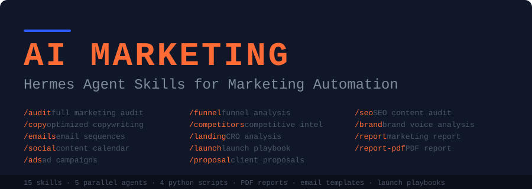

<p align="center">
  
</p>

# AI Marketing Suite cho Hermes Agent

Bộ 16 skill marketing cho [Hermes Agent](https://hermes-agent.nousresearch.com/docs): audit website, viết copy, email, lịch social, quảng cáo, phân tích đối thủ, đề xuất cho khách hàng và báo cáo PDF. Dùng được từ CLI hoặc chat qua Telegram/Discord/Slack với Hermes chạy trên VPS.

Chuyển từ [zubair-trabzada/ai-marketing-claude](https://github.com/zubair-trabzada/ai-marketing-claude) (bản gốc cho Claude Code, giấy phép MIT).

---

## Cài đặt trên VPS

### Cách 1 — nhờ Hermes tự cài (dễ nhất)

Nhắn cho Hermes (Telegram/CLI):

```
Clone https://github.com/vibeailabs-tech/ai-marketing-hermes.git vào ~/ai-marketing-hermes rồi chạy
~/ai-marketing-hermes/install.sh --external --with-pdf và báo kết quả cho tôi.
```

### Cách 2 — tự chạy lệnh

```bash
git clone https://github.com/vibeailabs-tech/ai-marketing-hermes.git ~/ai-marketing-hermes
cd ~/ai-marketing-hermes
./install.sh --external --with-pdf     # skill đọc thẳng từ repo; cập nhật bằng git pull
# hoặc
./install.sh --with-pdf                # copy vào ~/.hermes/skills/marketing
```

| Tuỳ chọn | Ý nghĩa |
|---|---|
| *(mặc định)* | Copy skill vào `~/.hermes/skills/marketing/`. Chạy lại sẽ ghi đè chỉnh sửa Hermes đã làm. |
| `--external` | Thêm repo vào `skills.external_dirs` trong `~/.hermes/config.yaml`. Cập nhật: `git -C ~/ai-marketing-hermes pull`. |
| `--with-pdf` | Cài `reportlab` cho báo cáo PDF. |

`--with-pdf` tự lo phần PDF kể cả khi Hermes chạy trong container không có `sudo`: thử `pip --user`, nếu bị chặn thì cài reportlab vào `~/.local/share/ai-marketing-hermes/pylib`, và tải font DejaVu (để PDF hiện tiếng Việt) vào `~/.local/share/ai-marketing-hermes/fonts` nếu máy chưa có font Unicode.

`--external` tự thêm repo vào `skills.external_dirs`, kể cả khi `config.yaml` đã có mục `skills:` (giữ nguyên comment, sao lưu ra `config.yaml.bak-aims`).

Sau khi cài, mở phiên Hermes mới (hoặc gửi một tin nhắn bất kỳ trong phiên đang mở) để Hermes nhận skill.

### Cách 3 — cài qua Skills Hub (có quét bảo mật)

```bash
hermes skills install vibeailabs-tech/ai-marketing-hermes/skills/marketing/market-audit
hermes skills install vibeailabs-tech/ai-marketing-hermes/skills/marketing/market       # cài từng skill cần dùng
```

Mỗi skill tự chứa đủ script/template nên cài lẻ vẫn chạy. Cách này không cài bundle; copy thư mục `bundles/` vào `~/.hermes/skill-bundles/` nếu cần.

### Yêu cầu

- Công cụ web của Hermes (`web_extract`, `web_search`): cần Nous Portal (`hermes setup --portal`) hoặc một key Firecrawl/Exa/Tavily/Parallel. Thiếu thì skill tự dùng `curl` và script Python có sẵn, kết quả kém hơn.
- `delegate_task` (toolset `delegation`) cho `/market audit` chạy 5 agent song song. Thiếu thì chạy tuần tự.
- Python 3.8+ (script chỉ dùng thư viện chuẩn, riêng PDF cần `reportlab`).

---

## Lệnh

| Lệnh | Việc làm | File kết quả |
|---|---|---|
| `/market audit <url>` | Audit toàn diện, 5 agent song song, chấm điểm 0–100 | MARKETING-AUDIT.md |
| `/market quick <url>` | Chấm nhanh trong 60 giây | (chỉ chat) |
| `/market copy <url>` | Chấm copy và viết lại kèm ví dụ trước/sau | COPY-SUGGESTIONS.md |
| `/market emails <topic/url>` | Chuỗi email (chào mừng, nuôi dưỡng, ra mắt) | EMAIL-SEQUENCES.md |
| `/market social <topic/url>` | Lịch nội dung 30 ngày | SOCIAL-CALENDAR.md |
| `/market ads <url>` | Chiến dịch quảng cáo đa nền tảng (+ ảnh concept nếu có `image_generate`) | AD-CAMPAIGNS.md |
| `/market funnel <url>` | Phân tích phễu bán hàng | FUNNEL-ANALYSIS.md |
| `/market competitors <url>` | Phân tích đối thủ | COMPETITOR-REPORT.md |
| `/market landing <url>` | CRO cho landing page | LANDING-CRO.md |
| `/market launch <product>` | Kế hoạch ra mắt theo tuần | LAUNCH-PLAYBOOK.md |
| `/market proposal <client>` | Đề xuất dịch vụ cho khách | CLIENT-PROPOSAL.md |
| `/market report <url>` | Báo cáo tổng hợp (Markdown) | MARKETING-REPORT.md |
| `/market report-pdf <url>` | Báo cáo PDF có biểu đồ | MARKETING-REPORT-<domain>.pdf |
| `/market seo <url>` | Audit SEO | SEO-AUDIT.md |
| `/market brand <url>` | Phân tích giọng thương hiệu (lưu vào memory) | BRAND-VOICE.md |
| `/market-watch` | Theo dõi thay đổi website khách và đối thủ (hằng tuần) | _watch/WATCH-<date>.md |

Mỗi skill cũng là lệnh riêng: `/market-audit <url>` = `/market audit <url>`.

**Bundle:**
- `/marketing-agency <url>` — audit + đối thủ + đề xuất + PDF (quy trình chào khách mới)
- `/marketing-content <url>` — giọng thương hiệu + copy + social + email + quảng cáo

**Ví dụ trên Telegram:** gửi `/market audit https://example.com`. Hermes trả về tóm tắt điểm số và gửi kèm file báo cáo.

---

## Cấu hình

| Khoá | Mặc định | Ý nghĩa |
|---|---|---|
| `skills.config.marketing.output_dir` | `~/marketing-reports` | Thư mục lưu kết quả, mỗi khách một thư mục con (`example-com/`) |
| `skills.config.marketing.language` | `vi` | Ngôn ngữ báo cáo (`vi`, `en`, ...) |
| `skills.config.marketing.watchlist` | `~/marketing-reports/watchlist.txt` | Danh sách site cho `/market-watch` |

Đặt giá trị: `hermes config set skills.config.marketing.language en`

Biến môi trường tuỳ chọn: `MARKETING_PDF_FONT=/đường/dẫn/font.ttf` (và `MARKETING_PDF_FONT_BOLD`) để đổi font PDF.

### Theo dõi tự động hằng tuần

`market-watch` là blueprint (lịch mặc định: 8h sáng thứ Hai). Cài xong Hermes chỉ **gợi ý** lịch, không tự bật:

1. Sửa `~/marketing-reports/watchlist.txt` (mỗi dòng `Tên | https://site.com`), hoặc nhắn Hermes "thêm site X vào watchlist".
2. Trong chat gõ `/suggestions` để bật lịch. Kết quả gửi về đúng kênh chat đó.

---

## Cấu trúc

```
skills/marketing/
├── market/                 # router: /market <lệnh>, quick snapshot
├── market-audit/
│   ├── SKILL.md            # điều phối 5 agent bằng delegate_task
│   ├── references/         # brief cho từng agent (content, conversion, competitive, technical, strategy)
│   └── scripts/            # analyze_page.py, competitor_scanner.py
├── market-report-pdf/scripts/generate_pdf_report.py
├── market-social/{scripts/social_calendar.py, templates/content-calendar.md}
├── market-emails/templates/email-{welcome,nurture,launch}.md
├── market-watch/{scripts/watch.py, templates/watchlist.txt}   # blueprint hằng tuần
└── ... (các skill còn lại)
bundles/                    # marketing-agency.yaml, marketing-content.yaml
skills.sh.json              # nhóm danh mục trên Skills Hub
tools/validate.py           # kiểm tra frontmatter, file tham chiếu, script trùng lặp
install.sh / uninstall.sh
```

`analyze_page.py` và `competitor_scanner.py` được copy vào nhiều skill để mỗi skill tự chứa đủ file. Sửa một bản thì copy sang các bản còn lại; `tools/validate.py` sẽ báo nếu các bản lệch nhau.

## Cách chấm điểm audit

| Hạng mục | Trọng số |
|---|---|
| Content & Messaging | 25% |
| Conversion Optimization | 20% |
| SEO & Discoverability | 20% |
| Competitive Positioning | 15% |
| Brand & Trust | 10% |
| Growth & Strategy | 10% |

## Gỡ cài đặt

```bash
./uninstall.sh
```

Nếu đã cài bằng `--external`, xoá đường dẫn repo khỏi `skills.external_dirs` trong `~/.hermes/config.yaml`. Báo cáo trong `~/marketing-reports` được giữ nguyên.

## Giấy phép

MIT, xem [LICENSE](LICENSE). Bản gốc © Zubair Trabzada.
